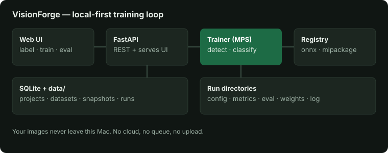

# VisionForge — train vision models on your Mac

[](LICENSE)
[](requirements.txt)
[](docs/ARCHITECTURE.md)

**Your own Roboflow-style trainer that never uploads anything.**
Organize projects, label images, train detection and classification models,
evaluate with real metrics, and export to Core ML — all on `localhost`.



## Why VisionForge

- **Private by construction** — images, labels, weights, and metrics live in
  one folder on your machine. Train time makes zero network calls.
- **Built for Apple Silicon** — torch/MPS acceleration with a zero-dependency
  numpy fallback, so it runs everywhere and flies on a MacBook.
- **Honest ML** — seeded train/val splits, held-out eval (mAP@0.5, IoU,
  confusion matrix), versioned datasets and augmentation recipes.
- **Reproducible runs** — every run directory carries its config, metrics,
  eval, weights, and log. Compare runs, download artifacts, re-run anything.

## 5-minute quickstart

```bash
git clone https://github.com/CloudCorpRecords/visionforge.git
cd visionforge
python3 -m venv .venv
source .venv/bin/activate
pip install -r requirements.txt
python visionforge.py init --demo
python visionforge.py serve
```

Open **http://127.0.0.1:8000** in your browser. For the full UI, build it once:

```bash
cd frontend && npm install && npm run build
```

## Tour

| Tab | What you do there |
| --- | --- |
| Projects | Create detection/classification projects |
| Datasets | Upload images, import folders or video frames, preview augmentations |
| Label | Draw boxes (drag), keyboard-first (n/p/s/d), one-click proposals, hardest-first queue |
| Train | Pick backend/task/augment, watch live curves, read mAP + confusion matrix, open run cards |
| Models | Export `.npz` / `.onnx` / `.mlpackage`, browse and download the registry |

CLI-first? Everything the UI does is one command:

```bash
python visionforge.py import-folder --dir ~/Photos/pets
python visionforge.py import-video --file clip.mp4 --fps 1
python visionforge.py train --epochs 60 --task detect --augment v2-photo
python visionforge.py export --format coreml
```

## Tech

Python · FastAPI · PyTorch (MPS) · SQLite · React + Vite · Core ML Tools · ONNX

Architecture and module map: [docs/ARCHITECTURE.md](docs/ARCHITECTURE.md).
25-test suite: `.venv/bin/python -m pytest -q`.

## Roadmap

Multi-object detection heads · hyperparameter search · SAM-assisted labeling ·
experiment run cards to share · packaged Mac app + menubar companion.

## License

MIT — see [LICENSE](LICENSE). Contributions welcome ([guide](CONTRIBUTING.md)).
